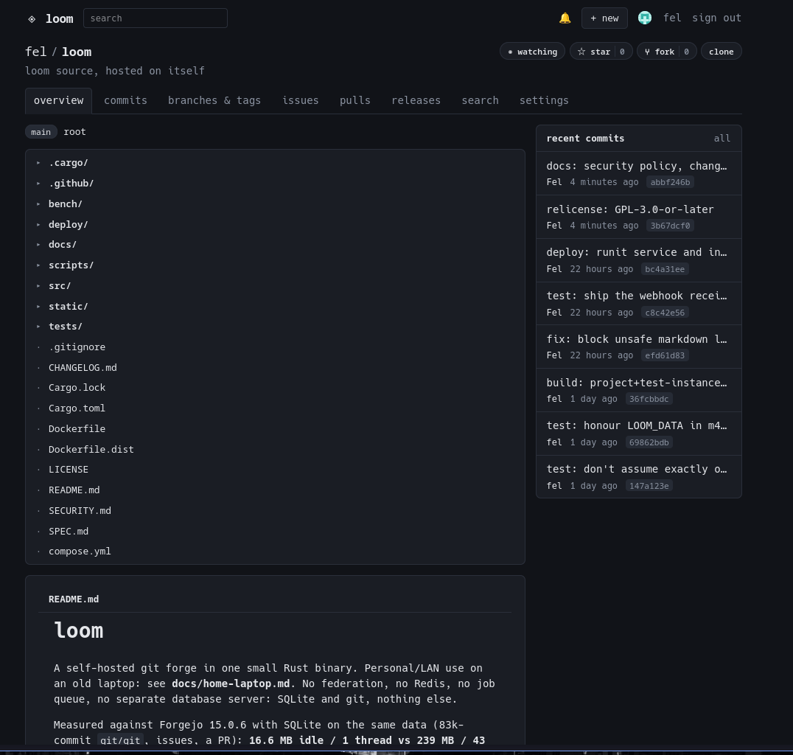
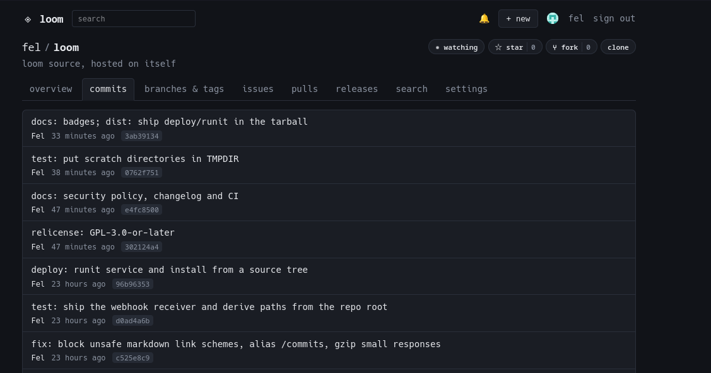
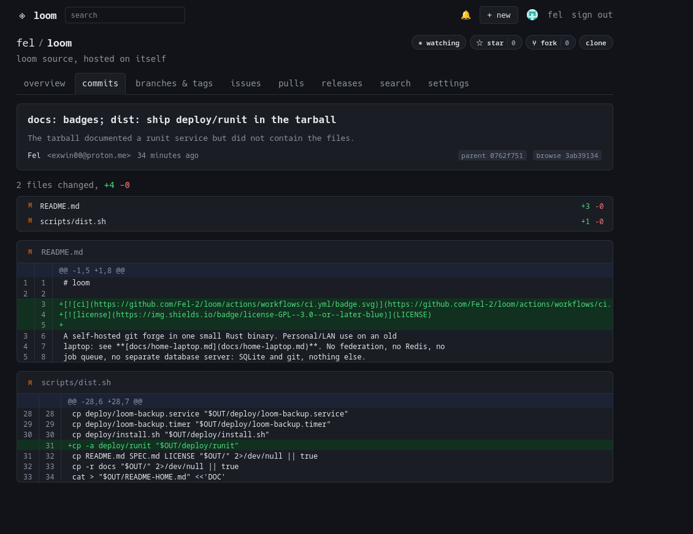

# loom

[](https://github.com/Fel-2/loom/actions/workflows/ci.yml)
[](LICENSE)

A self-hosted git forge in one small Rust binary. Personal/LAN use on an old
laptop: see **[docs/home-laptop.md](docs/home-laptop.md)**. No federation, no Redis, no
job queue, no separate database server: SQLite and git, nothing else.

## Why this exists

A 2017 i7-8550U with 8 GB of RAM and a 15 W power cap is a fine computer until
you put a forge on it. Forgejo with SQLite idled at 239 MB and 43 threads there —
more memory than the browser used to read it.

loom is the forge I wanted on that machine: SQLite and git, one thread when
nothing is happening, pages that render in about a millisecond, nothing else to
keep alive. It is not trying to replace a hosted forge for a team of fifty; it is
trying to be the thing you run on the machine you already have.

## Footprint

Same repositories, same host (20 cores), Forgejo 15.0.6 with SQLite and default
settings — an 83k-commit `git/git`, an issue tracker and a pull request:

| | loom | Forgejo |
|---|---|---|
| idle RSS / threads | **16.6 MB / 1** | 239.4 MB / 43 |
| peak RSS, 32 concurrent clients | **87.5 MB** | 353.5 MB |
| peak process tree, same load | 87.5 MB | 988.6 MB (58 `git` children) |
| requests/s, 32 clients | **1,176** | 49 |
| issue list, 1 client | **0.73 ms** | 14.6 ms |
| API: issues | **0.29 ms** | 10.3 ms |
| raw file | **1.8 ms** | 13.6 ms |
| log, page 1 | **2.3 ms** | 38 ms |

**Read this before quoting the numbers.** Tree and blob pages look dramatically
faster partly because loom does less: it skips per-file "last commit" badges
(Forgejo spends about a second on a large directory) and had no syntax
highlighting when the benchmark ran. Those rows are marked as not comparable in
[`bench/results/SUMMARY.md`](bench/results/SUMMARY.md), which also carries the
method and the raw output, so the comparison can be judged instead of believed.

**Status: 0.1.0.** The web UI, git transport (HTTP + SSH), issues, pull
requests, LFS, releases and the REST API work and are covered by tests. Treat it
as a single-user/LAN forge, not a hardened multi-tenant service: there is no
federation, no built-in CI runner and no package registry. See
[SECURITY.md](SECURITY.md) for the threat model before exposing it.

## Screenshots

Every page is server-rendered HTML; no JavaScript is needed to browse, file an
issue or merge a pull request.

Repository overview — tree, recent commits, rendered README:



Commits, and a single commit with its diff:




## What it does

- **Browse**: tree, blob (with a small built-in syntax highlighter), raw, log,
  path-limited history, commit + diff, branches & tags, blame, README rendering.
  Everything revalidates by ETag; raw files are cacheable forever by content.
- **Accounts**: local users, argon2id passwords, sessions, SSH keys, API tokens
  (web UI or `loom token add`), optional TOTP two-factor (with
  `loom user 2fa-off` as recovery).
- **Orgs**: members with read/write/admin across the org's repositories.
- **Transport**: embedded SSH server (no OpenSSH needed) and smart HTTP, both
  streaming into short-lived `git upload-pack`/`receive-pack` processes.
- **Repos**: settings, collaborators, branch protection (no force-push, no
  delete, PRs only, required status checks), archive, rename, transfer, delete
  (moved to `data/trash/`, recoverable), forks (hardlinked), stars, watch.
- **Pull mirrors**: periodic fetch from an upstream URL; mirrored repos are
  read-only.
- **Issues & PRs**: shared numbering, labels, milestones, assignees, timeline,
  emoji reactions; `#12` / `owner/repo#12` / `@user` / sha references that only
  link when the viewer may see the target; `Fixes #12` closes on merge or on
  push to the default branch. PRs: draft or ready, fork heads, revisions per
  push with `git range-diff`, reviews, no-JS inline comments, merge/squash/
  rebase, "merged by push".
- **Git LFS**: batch API, uploads verified by SHA-256, `git-lfs-authenticate`
  over SSH so LFS works with SSH remotes too; storage under `data/lfs/`.
- **Releases**: notes per tag, drafts and pre-release flags, uploaded assets
  with download counts, source tarballs (`git archive`).
- **Templates**: `ISSUE_TEMPLATE/*.md` and `PULL_REQUEST_TEMPLATE.md` from
  `.loom/` or `.github/` prefill new issues and PR descriptions.
- **Org teams**: members with a role per team, and per-repo grants.
- **Extras**: deterministic identicon avatars (no external service), a commit
  graph view (`git log --graph`), opt-in "last commit" badges per repo
  (off by default: they cost ~1 s per large directory), per-IP rate limiting,
  email notifications piped to your MTA, `loom lfs gc`, Atom feeds for
  commits, issues and releases (session cookie or API token — so feed
  readers can follow private repos too), a `Content-Security-Policy` that
  denies scripts outright, and OpenGraph tags for link previews.
- **Integrations**: signed webhooks with retries and a delivery log, commit
  statuses API + combined status, REST API v1 with bearer tokens
  ([docs/api.md](docs/api.md) — issues, labels, milestones, releases, PR
  create/merge, hooks), notifications, activity feed, full-text search
  (issues/PRs/comments) and code search (`git grep`), and a Forgejo/Gitea
  import script that also copies issues, labels, milestones and releases
  ([scripts/import-forgejo.sh](scripts/import-forgejo.sh)).

## Run it

Building needs Rust 1.85 or newer (edition 2024) and a C toolchain for the
bundled SQLite. The release binary needs neither: it is statically linked.

```sh
cargo build --release
LOOM_DATA=./data LOOM_ADDR=127.0.0.1:3000 LOOM_URL=http://127.0.0.1:3000 \
  ./target/release/loom serve

# create the first admin (reads the password from stdin)
printf 'a-long-password' | ./target/release/loom user add you --admin --password-stdin
./target/release/loom repo create you/hello --desc "first repo"
```

`loom --help` lists the admin commands (`user`, `key`, `repo`, `org`, `hook`).

### Configuration

| Variable | Default | Meaning |
|---|---|---|
| `LOOM_DATA` | `./data` | Database, repositories, hooks, trash, release assets |
| `LOOM_ADDR` | `127.0.0.1:3000` | HTTP listen address |
| `LOOM_URL` | `http://$LOOM_ADDR` | Public URL (clone links, webhook payloads) |
| `LOOM_SSH_ADDR` | `127.0.0.1:2222` | SSH listen address; `off` disables |
| `LOOM_SSH_HOST` | same as SSH addr | Host:port shown in SSH clone URLs |
| `LOOM_TRUST_PROXY` | unset | `1` trusts `X-Forwarded-For` (behind a reverse proxy) |
| `LOOM_GIT_THREADS` | `4` | Blocking threads for git work |
| `LOOM_MAX_GIT` | `8` | Max concurrent streaming git processes (clones/pushes) |
| `LOOM_LFS_MAX_MB` | `2048` | Largest single LFS object |
| `LOOM_RATE_READ` | `2000` | Requests/second/IP for reads (0 disables) |
| `LOOM_RATE_WRITE` | `100` | Requests/second/IP for writes (0 disables) |
| `LOOM_MAIL_CMD` | unset | Send notification mail with this command (e.g. `/usr/sbin/sendmail -t`) |
| `LOOM_MAIL_FROM` | `loom <loom@localhost>` | From: header |

Backups: `sqlite3 data/loom.db ".backup out.db"` plus `data/repos/`.

## Deploy

- **Home laptop (personal, LAN, no root)**: `./scripts/dist.sh` builds a
  static binary tarball; `./deploy/install.sh` on the laptop installs it under
  `~/.local` with a systemd user unit and a daily backup timer. Full guide:
  **[docs/home-laptop.md](docs/home-laptop.md)**.
- **Container (podman)**: `podman build -t loom .` then
  `podman run -d --name loom -p 3000:3000 -p 2222:2222 -v ./data:/data:Z -e LOOM_URL=http://localhost:3000 loom`
  (or `podman-compose up -d`). The runtime image carries git. First admin:
  `podman exec -u loom loom loom user add you --admin --password-stdin`.
  The container runs as uid 10001, so a bind-mounted `./data` is owned by that
  uid — either `chown -R 10001 data` on the host (if you want direct access for
  backups) or use a named volume.
- **systemd**: `deploy/loom.service` (hardened: loom can only write
  `LOOM_DATA`). Put a reverse proxy in front for TLS and set `LOOM_URL` to the
  public URL; add `LOOM_TRUST_PROXY=1` if the proxy sets `X-Forwarded-For`.
- **Health / metrics**: `GET /healthz` (JSON, 503 when the DB or storage is
  broken) and `GET /metrics` (Prometheus text: uptime, request counters,
  in-flight requests, free git slots, RSS, threads, repo count).
- **Maintenance**: `loom doctor` (is this machine ready?), `loom backup
  <dir> --repos --keep N`, `loom restore <db> --repos <dir>`,
  `loom lfs gc [--dry-run]` deletes LFS objects no longer
  referenced by any ref (and objects of deleted repositories);
  `loom mail flush` sends queued notifications; `loom repo maintain` rebuilds
  commit-graphs.
- **Backups**: `loom backup /backups --repos` writes a consistent SQLite
  snapshot (`VACUUM INTO`) plus a copy of the repositories (reflink when the
  filesystem supports it). Run it from cron; restore is "stop loom, put the
  files back".
- **Upgrades**: replace the binary and restart. Git hooks call the binary by
  path, resolved at startup, so an in-place upgrade doesn't break pushes
  (`loom repo maintain` rebuilds commit-graphs if you changed git versions).

## Tests

`tests/*.sh` run against a live instance (default `127.0.0.1:3917`, seeded with
users `alice` (admin, `alice-test-pw`), `bob` (`bob-test-pw1`), repos
`alice/ytm-tui`, `alice/secret`, `alice/slate`, `git/git`, and test keys in
`~/.cache/loom-bench/keys`). They always run git with an empty config, so no
credential helper or GUI prompt is involved.

```sh
tests/smoke.sh   # transport + permissions (25)
tests/m3.sh      # repo management, orgs, protection, forks (63)
tests/m4.sh      # issues, labels, milestones, references (66)
tests/m5.sh      # pull requests, revisions, drafts (81)
tests/m6.sh      # webhooks, statuses, API, feeds, headers, reactions, search (124)
tests/m7.sh      # highlighting, caps, blame, releases, 2FA, mirrors (48)
tests/m8.sh      # LFS (real git-lfs), healthz, metrics, backup, version (21)
tests/m9.sh      # templates, drafts, avatars, graph, teams, email, LFS gc, rate limits (43)
tests/m10.sh     # doctor, backup rotation, restore, installer, forgejo import, static binary (38)
cargo test --release   # unit tests (TOTP, HMAC, tokenizer, highlighter, access matrix, ...)
```

`bench/` holds the Forgejo comparison harness, and `bench/guard.sh` (run in
CI) fails the build if loom's idle RSS outgrows its budget.

## Not implemented

Per-file "last commit" badges in tree views — Forgejo spends ~1 s per large
directory on those, which is exactly the latency loom avoids. (Git LFS is
supported.)

## License

GPL-3.0-or-later. See [LICENSE](LICENSE).

Copyleft: run a modified loom for other people and the source has to stay
available. Every dependency is Apache-2.0, MIT, ISC or BSD — all compatible with
GPLv3, so there is no licensing asterisk on the build.
